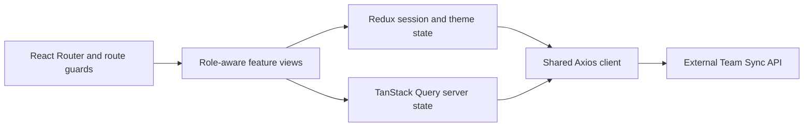

# Team Sync

Team Sync is a role-based workforce management frontend built for employee administration and team collaboration. It provides separate admin and employee workspaces, protected navigation, API-backed authentication, employee directory management, and persistent light and dark themes.

> This repository contains the frontend application. It connects to the hosted Team Sync API.

**Status:** in development. The repository demonstrates the client integration and state architecture; it does not contain the API server or establish that all hosted workflows are currently available.

## Architecture



- [`src/app/`](src/app/) owns layouts, routing, navigation, guards, and the Redux store.
- [`src/features/auth/`](src/features/auth/) owns sign-in, current-session state, and auth UI.
- [`src/features/`](src/features/) groups the application views, API calls, hooks, and feature state.
- [`src/config/axiosInstance.jsx`](src/config/axiosInstance.jsx) supplies the API base URL, credentialed requests, and one refresh-and-retry attempt for a 401 response.

Client route guards control navigation, not server authorization. The API must independently validate sessions, roles, and employee-management permissions.

## Features

### Implemented

- Email and password sign-in
- Cookie-based session restoration and automatic access-token refresh
- Protected routes for authenticated users
- Role-based admin and employee routes
- Role-aware dashboard navigation
- Employee directory with search, filters, pagination, and status statistics
- Add-employee form with validation
- Employee status updates
- Persistent light and dark themes
- Shared Axios API client
- Server-state caching with TanStack Query

### In progress

Routes and initial pages are scaffolded for:

- Tasks and personal tasks
- Chats
- Departments
- Documents
- Attendance
- Employee profiles
- Settings
- User registration

## Tech Stack

- React 19
- Vite 7
- React Router
- Redux Toolkit and React Redux
- TanStack Query
- Axios
- React Hook Form
- Tailwind CSS 4
- Lucide React

## Getting Started

### Prerequisites

- Node.js `^20.19.0` or `>=22.12.0`
- npm

### Installation

```bash
git clone https://github.com/sayedrisat/Team-Sync.git
cd Team-Sync
npm ci
npm run dev
```

Open the local URL displayed by Vite in the terminal.

## API Configuration

The application currently connects to:

```text
https://api.team-sync.space/api
```

The Axios client is configured in `src/config/axiosInstance.jsx`. Authentication uses cookies, so the API must accept credentialed requests from the frontend origin.

No `VITE_*` environment configuration is currently read by this client; changing the API host requires editing that source file. Do not put server signing keys or database credentials into Vite variables, which are shipped to the browser. Running the UI locally does not start a backend.

## Available Scripts

| Command | Purpose |
| --- | --- |
| `npm run dev` | Start the development server |
| `npm run build` | Create a production build |
| `npm run lint` | Run ESLint |
| `npm run preview` | Preview the production build locally |

## Project Structure

```text
src/
|-- app/          # Layouts, routes, route guards, store, and navigation
|-- config/       # Axios and API configuration
|-- features/     # Feature-based pages, components, hooks, APIs, and state
|-- shared/       # Shared application state
|-- index.css     # Tailwind import and global theme variables
`-- main.jsx      # Application entry point
```

## Current Status

Authentication and the admin employee-management flow are connected to the API. Several collaboration modules are currently represented by route and page scaffolds and remain under development.

There is no automated test script or CI workflow in this checkout. Use `npm run lint` and `npm run build` for static checks, then verify sign-in, session restoration, sign-out, role boundaries, employee mutations, and expired-session behavior against an authorized test API. A production build alone does not prove those flows work. No frontend deployment URL is currently published in the repository metadata.

## License

No license has been specified for this project.
